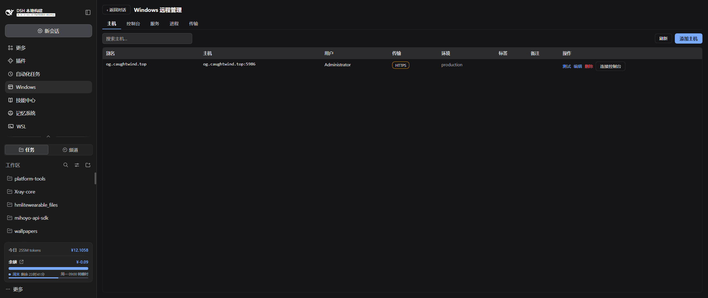

# dsh-winrm — Windows 远程管理插件（WinRM / PowerShell Remoting）

中文 | [English](README.en.md)

仿照 [dsh-ssh](https://github.com/zhu1090093659/dsh-web-ui/tree/main/packages/dsh-ssh) 开发的 DSH 插件：用 Windows 原生的 **WinRM / PowerShell Remoting** 协议远程管理 Windows 服务器，**目标机不需要装 OpenSSH**。

> **来源**：本项目是 [andyfan1094/dsh-winrm](https://github.com/andyfan1094/dsh-winrm)（Apache-2.0）的分支，把后端的 WinRM 实现从 Python + pywinrm 换成原生 Node.js 客户端（[winrm-client](https://github.com/shide1989/winrm-client)），因此**本机不再需要 Python**。GUI、Agent 工具与功能范围沿用上游设计。

## 功能

| 面 | 说明 |
| --- | --- |
| GUI 侧边栏「Windows」入口 | 居中面板：**主机** / **控制台** / **服务** / **进程** / **传输** 五个页签 |
| Agent 工具 | `winrm_list` `winrm_exec` `winrm_service` `winrm_process` `winrm_read` `winrm_write` `winrm_edit` `winrm_upload` `winrm_download` `winrm_cluster` |
| PowerShell 控制台 | WebSocket 命令会话（每条命令通过原生 Node WinRM 客户端执行，输出实时返回） |
| 服务管理 | 列出 / 启动 / 停止 / 重启 / 改启动类型（自动/手动/禁用） |
| 进程管理 | 列出（CPU/内存/路径）/ 按 PID 结束 |
| 远程文本文件 | 读（按行分页、编码感知、行号信封）/ 写（整文件覆盖，可选 UTF-8 / UTF-8 BOM / UTF-16LE）/ 编辑（精确串替换，保持原编码，非唯一匹配默认拒绝） |
| 转录卡片 | `winrm_read` / `winrm_write` / `winrm_edit` 在会话里渲染为**文件内容卡片与 diff 卡片**（直接复用 harness 自带的 `ReadBlock` / `DiffBlock` 原语），不再是模型可见的原始信封文本 |
| 文件传输 | WinRM 流式传输（上传单 shell 单流 / 下载并行区间，**不依赖 SMB**，任意路径可传）；上传自动建目录 |
| 集群 | 一条命令并发跑多台主机（按 aliases / environment / tags 过滤） |

## 认证与传输

- 使用原生 Node.js WinRM 客户端（[winrm-client](https://github.com/shide1989/winrm-client)），按传输自动选择认证：HTTPS 优先 Basic、HTTP 优先 NTLM，两者均自动回退（HTTP Basic 仅限受信内网，公网必须使用 HTTPS）
- 本地账户可写 `Administrator`；域账户可写 `DOMAIN\user` 或 `user@domain`
- 本机无需 Python —— WinRM 走纯 Node 依赖（winrm-client），随插件一起安装
- 传输：HTTP(5985) 或 HTTPS(5986)；HTTPS 可勾选「接受自签名证书」
- 中文输出不乱码：所有命令走 **UTF-8 base64 信封**（`Out-String -Stream` 包装 + 三条带标签的信封行），绕过 WinRM 传输的代码页问题
- 命令结果的 `stderr` 已自动剥离 PowerShell 的 CLIXML 宿主机记录；真实的进程级 stderr（如 `[Console]::Error`）原样保留
- **脚本走 WinRS stdin，不走命令行**：WinRS 把命令行交给 `cmd.exe`，上限约 8191 字符，而 `-EncodedCommand` 会把脚本膨胀 2.67 倍 —— 命令行长脚本此前会直接报 `The command line is too long.`。现在命令行是**常量**，脚本按 UTF-8 字节数分块送到 stdin，实测 200 KB 脚本正常

## 目标机准备（一次性）

在要管理的 Windows 机器上，**以管理员身份**运行：

```powershell
powershell -ExecutionPolicy Bypass -File .\scripts\enable-winrm.ps1
```

脚本自动：启用 WinRM 服务与 5985 监听 → 开放 Basic/Negotiate 认证 → 允许 HTTP 明文（内网）→ WinRS 内存上限 512MB → 放行防火墙 → 打印本机 IP。

> ⚠️ **安全**：HTTP + Basic 是明文，仅限受信内网；公网请配置 HTTPS + 自签名证书，并在插件里勾选「接受自签名证书」。密码明文存于本机 `~/.dsh/dsh-winrm.json`（0600 权限，仅当前用户可读），插件界面永不回显。

## 截图



## 安装

> 需要 DeepSeek Harness **0.1.7-alpha.2 及以后**（含 `0.1.7-rc.1`、`0.2.0-rc.*`、`0.2.x`）。插件的 `peerDependencies` 声明为 `^0.1.7-alpha.2 || ^0.2.0-rc.1`，DSH 启动时会据此校验：0.1.7 与 0.2.x 各版本可加载，`0.3.0` 起会被拒绝（确需冒险可用 `dsh plugin allow-version` 逐版本放行）。

从 [Releases](https://github.com/MoRanYue/dsh-winrm/releases) 下载最新的 `dsh-winrm-*.tgz`，加入 profile：

```powershell
dsh plugin --profile web add D:\downloads\dsh-winrm-0.3.1.tgz
```

也可以直接从 npm 安装：

```powershell
dsh plugin --profile web add dsh-winrm
```

本地开发可用 profile 链接安装：

```bash
dsh plugin --profile web add link:D:\项目\dsh-winrm
```

安装后 **重启 dsh web**（退出再启动 `dsh web`）使插件生效。侧边栏出现「Windows」入口；对话中可直接用 `winrm_list` 等工具。

### 从源码构建

```bash
cd D:\项目\dsh-winrm
pnpm install
npm run build     # tsc 声明 + tsdown 宿主/客户端打包 + postbuild 包装
```

## 使用示例（agent 工具）

```
winrm_list                                        # 列出已配置主机
winrm_exec  alias=web1 command="Get-Service | Select -First 5 | Format-Table"
winrm_service alias=web1 name=W3SVC action=restart
winrm_process alias=web1 action=list
winrm_process alias=web1 id=1234 action=kill
winrm_read   alias=web1 remotePath=C:\logs\app.log offset=1 limit=200
winrm_write  alias=web1 remotePath=C:\temp\run.ps1 content="$env:TEMP" encoding=utf8bom
winrm_edit   alias=web1 remotePath=C:\temp\app.config oldString="port=8080" newString="port=9090"
winrm_upload alias=web1 localPath=D:\a.zip remotePath=C:\temp\a.zip
winrm_download alias=web1 remotePath=C:\logs\app.log localPath=D:\app.log
winrm_cluster command="Get-Date" tags=prod
```

## 架构

```
src/
  index.ts            Cordis 插件入口（webServer/tools/systemPrompt 挂载 + 设置面板 + 公告）
  engine.ts           WinRmEngine 门面：exec / services / processes / readFile / writeFile / editFile / ls / upload / download / console / cluster / test
  store.ts            ~/.dsh/dsh-winrm.json 主机存储（原子写，0600）
  protocol.ts         宿主↔浏览器 wire 类型
  diff.ts             转录卡片用的有界 hunk 推导（不依赖 diff 包）
  powershell.ts       PS 片段构造器 + stdin 信封（outer/child 包装 / 服务 / 进程 / 目录 / 流式收发脚本）
  routes.ts           /api/dsh-winrm 路由族 + 控制台 WebSocket（loopback 围栏）
  tools.ts            10 个 winrm_* agent 工具
  engine/client.ts    winrm-client 传输层：进程内认证（NTLM/Basic）、UTF-8 信封、流式上传/下载 + 分块回退
  engine/wsman.ts     手写 WSMan Send/Receive 信封（原始字节走 stdin，不做二次 base64；512000 信封上限）
  engine/console.ts   流式 PowerShell 控制台会话
  client/             浏览器半：侧边栏入口 + 居中面板（5 页签）
  client/tool/        转录卡片：tool.call.toolview 三个帧 + DSH 原生 ReadBlock / DiffBlock 渲染
scripts/
  enable-winrm.ps1    目标机一键启用 WinRM
  postbuild.mjs       客户端产物 __ModuleLoader__ 包装
```

传输依赖原生 Node.js 的 [winrm-client](https://github.com/shide1989/winrm-client)（NTLM/Basic，进程内认证）；密码只在宿主进程内使用，不出现在任何子进程命令行参数中。

### SMB 通道与自定义端口

`channel=smb`/`auto` 的快速路径默认连目标机的 445。主机配置里的「SMB 端口」可以改成别的值，但 Windows **不能**改 SMB 的 TCP 监听端口（[官方文档](https://learn.microsoft.com/zh-cn/windows-server/storage/file-server/smb-ports)只允许改 QUIC 端口），所以非 445 一定意味着目标机前面有转发：

```powershell
# 目标机：把 1445 转发到本机 445，只对指定来源放行
netsh interface portproxy add v4tov4 listenport=1445 listenaddress=0.0.0.0 connectport=445 connectaddress=127.0.0.1
New-NetFirewallRule -DisplayName 'dsh-winrm: SMB 1445' -Direction Inbound -Action Allow `
  -Protocol TCP -LocalPort 1445 -RemoteAddress <运行 dsh 的机器的出口 IP>
```

填了非 445 端口后，传输改用 `New-SmbMapping -TcpPort` 把共享挂到空闲盘符（Z 往下找），拷完 `Remove-SmbMapping` 卸掉。`New-SmbMapping` 的 `-TcpPort` 需要**运行 dsh 的这台机器**是 Windows 11 24H2 / Windows Server 2025 或更新版本；凭据经环境变量交给 PowerShell，不进命令行。


## 已知限制

- 控制台是命令会话，不保持 PowerShell 变量和当前目录状态；每条命令独立执行
- 上传走**单条 stdin 流**：一个 shell、一个命令，每 256KB 一个 `Send`，可压缩内容自动按块 gzip（实测 1.7MB JSON 线上仅 91KB）。旧的 48KB 分块路径保留为回退，仅在流式通道不可用时启用
- 下载走**并行区间流**：默认最多 4 个 worker，各自一个 shell 读同一文件的绝对字节区间，远端 gzip 后回传，本地按 offset 落位（实测 2MiB 约 10-12 秒，16MiB 约 21-23 秒，可压缩的 16MiB 约 6 秒；旧的 48KB 分块路径 2MiB 需 129 秒，保留为回退）。服务端单次 `Receive` 最多回 128KB，与信封大小无关，所以下载是往返次数受限而非带宽受限
- `channel=auto`（默认）先探测目标机的 SMB 端口：`net use` 自身没有短超时，SMB 不可用时要等约 60 秒才失败，此前这段等待发生在每次上传之前。现在 3 秒内判定并直接走 WinRM；显式 `channel=smb` 且端口未开放时立即报错，并提示改用 `winrm`
- 自定义 SMB 端口（非 445）依赖目标机的端口转发，且运行 dsh 的机器需 Windows 11 24H2 / Server 2025 以上（`New-SmbMapping -TcpPort`）；Windows 不能直接改 SMB 的 TCP 监听端口
- 流式传输以**字节是否还在流动**判定超时，而不是给整次传输一个固定时限：只要还有数据到达就继续，某条区间连续 180 秒没有任何字节才判失败。因此大文件（实测 700MiB）在该链路的约 0.73MiB/s 速率下会跑十几分钟并正常完成；绝对上限只是防止传输卡死后永久占用，按载荷大小放大
- 下载失败不留残留文件：已写入的数据会被丢弃、目标文件被删除；若失败发生在任何字节到达之前（路径不存在、目标是目录、主机不可达），已存在的本地文件保持原样不动（目标文件在首次写入时才创建）
- 一次传输被中途放弃时（例如某次认证尝试失败后从头重试），目标机上的发送进程可能残留并继续占用该文件，直到其 shell 被回收；正常结束的传输会自行退出。遇到远端文件删不掉时，先结束目标机上对应的 `powershell.exe` 发送进程再删
- 单命令默认 60s 超时，可传 `timeoutMs`
- 目标机需已启用 WinRM（见上）；HTTP 明文 Basic 不应用于公网
- 面板关闭再打开会回到「主机」页签：面板是 `main` 插槽的占用者，切回对话时卸载，页签状态不跨开关保留
